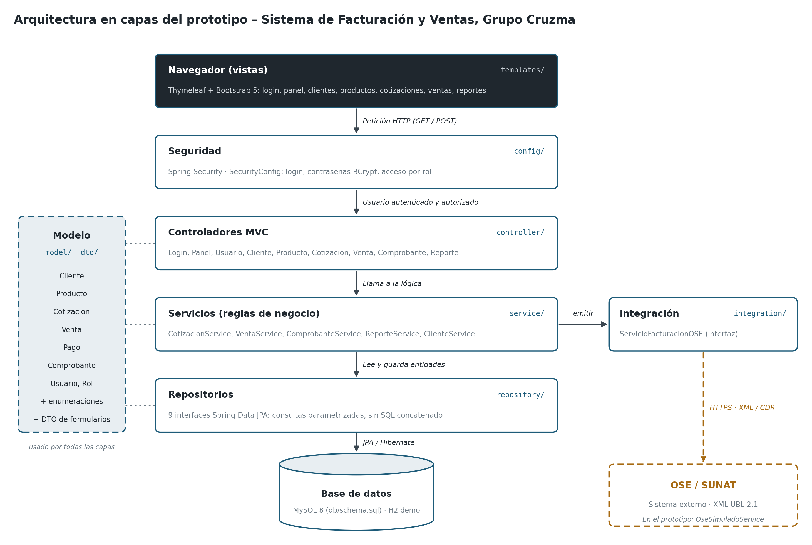

# Arquitectura

Aplicación web monolítica en **Spring Boot 3.3 (Java 17)** con arquitectura en capas y vistas generadas en el servidor (Thymeleaf).

## Capas y paquetes

| Paquete | Capa | Responsabilidad | Depende de |
|---------|------|-----------------|------------|
| `controller` | Presentación | Recibir formularios, llamar al servicio, elegir la vista y mostrar mensajes | `service`, `model`, `dto` |
| `service` | Negocio | Reglas de negocio y transacciones (`@Transactional`) | `repository`, `integration`, `model` |
| `repository` | Datos | Consultas con Spring Data JPA, siempre parametrizadas | `model` |
| `model` | Dominio | Entidades JPA y reglas que dependen solo de sus datos | — |
| `integration` | Integración | Contrato con el proveedor de facturación electrónica | `model` |
| `dto` | Transporte | Datos de formularios y reportes | — |
| `service.exportacion` | Negocio | Exportar reportes a Excel (POI) y CSV (Commons Text) | `dto`, `util` |
| `util` | Transversal | Tratamiento seguro de datos y auditoría (Commons Lang, Logback) | — |
| `config` | Transversal | Seguridad y datos de demostración | `repository`, `model` |

**Regla:** las dependencias van solo hacia abajo. Un controlador nunca usa un repositorio directamente y una entidad nunca llama a un servicio.

## Flujo de una petición

Ejemplo: el cajero emite una boleta (`POST /ventas/5/emitir`).

1. **Spring Security** verifica que el usuario tenga rol `ADMIN` o `CAJA` (`SecurityConfig`).
2. **`VentaController.emitir`** recibe el tipo de comprobante.
3. **`ComprobanteService.emitir`** abre una transacción, valida la precondición del CU08 (venta con pago y sin comprobante vigente),
   calcula serie y correlativo y crea el `Comprobante`, que separa el IGV.
4. **`ServicioFacturacionOSE.enviar`** envía el comprobante; en el prototipo responde `OseSimuladoService`.
5. El servicio guarda la respuesta; el controlador redirige a `/ventas/5` con el mensaje del OSE.

## Decisiones de diseño

| Decisión | Motivo |
|----------|--------|
| Reglas de cálculo dentro de las entidades (`Venta.registrarPago`, `Comprobante`) | Se prueban sin base de datos y no se duplican |
| Interfaz `ServicioFacturacionOSE` | Cambiar de proveedor (o pasar de simulado a real) sin tocar servicios ni controladores |
| Inyección por constructor | Dependencias explícitas y clases fáciles de probar |
| Precios con IGV incluido | Así cotiza la empresa; el IGV se separa recién en el comprobante |
| H2 por defecto y MySQL con perfil | Demostrar sin instalar nada y usar el diseño físico real en producción |
| Thymeleaf y no una SPA | Un solo proyecto Java, menos piezas para un equipo pequeño |
