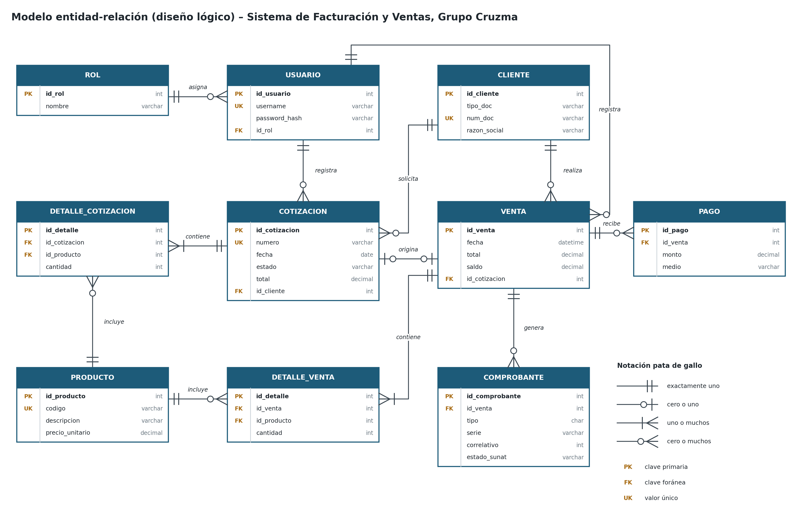

# Modelo de datos

10 tablas en MySQL 8. El script completo está en [`db/schema.sql`](../db/schema.sql); cada entidad de `model/` mapea una tabla.

## Tablas y entidades

| Tabla | Entidad | Contenido | Claves y restricciones |
|-------|---------|-----------|------------------------|
| `rol` | `Rol` | ADMIN, VENDEDOR, CAJA | `nombre` único |
| `usuario` | `Usuario` | Usuarios del sistema | `username` único; FK `id_rol` |
| `cliente` | `Cliente` | Personas y empresas | `num_doc` único; `tipo_doc` ENUM DNI/RUC |
| `producto` | `Producto` | Catálogo con precio con IGV | `codigo` único; `precio_unitario >= 0` |
| `cotizacion` | `Cotizacion` | Cabecera de la cotización | `numero` único; FK cliente y usuario |
| `detalle_cotizacion` | `DetalleCotizacion` | Ítems con medidas | `cantidad > 0`; borrado en cascada con la cotización |
| `venta` | `Venta` | Venta, total y saldo | `id_cotizacion` único (una cotización, una venta) |
| `detalle_venta` | `DetalleVenta` | Ítems copiados de la cotización | `cantidad > 0` |
| `pago` | `Pago` | Adelantos y pagos | `monto > 0`; `medio` ENUM |
| `comprobante` | `Comprobante` | Facturas, boletas y notas de crédito | `serie + correlativo` únicos; `tipo` '01', '03', '07' |

## Tablas de auditoría (v0.4.0)

| Tabla | Contenido | Claves |
|-------|-----------|--------|
| `revinfo` | Una fila por transacción que cambió datos: fecha y usuario | `id_revision` |
| `cliente_aud`, `producto_aud`, `usuario_aud`, `cotizacion_aud`, `venta_aud`, `pago_aud`, `comprobante_aud` | Versión de cada registro en cada revisión y tipo de operación (`revtype`) | PK (`id_...`, `rev`); FK `rev` → `revinfo` |

Las genera Hibernate Envers; detalle en [auditoria-de-datos.md](auditoria-de-datos.md).

## Relaciones

| Relación | Cardinalidad | En JPA |
|----------|--------------|--------|
| Rol – Usuario | 1 a muchos | `@ManyToOne` en `Usuario.rol` |
| Cliente – Cotización / Venta | 1 a muchos | `@ManyToOne` |
| Cotización – Detalle | 1 a 1..muchos, composición | `@OneToMany(cascade = ALL, orphanRemoval = true)` |
| Cotización – Venta | 0..1 a 0..1 | `@OneToOne` con `unique = true` |
| Venta – Pago | 1 a muchos, agregación | `@OneToMany(mappedBy = "venta")` |
| Venta – Comprobante | 1 a muchos | Factura o boleta más su nota de crédito si se anula |

## Convenciones de mapeo

- Columnas en `snake_case`; Spring las deriva del atributo `camelCase` (`numDoc` → `num_doc`). Los ids se nombran con `@Column(name = "id_...")`.
- Enumeraciones con `@Enumerated(EnumType.STRING)`, salvo `TipoComprobante`, que `TipoComprobanteConverter` guarda como código SUNAT (`01`, `03`, `07`).
- Dinero en `BigDecimal` / `DECIMAL(12,2)`; nunca `double`.
- En el perfil `mysql` Hibernate no crea tablas (`ddl-auto=none`): el esquema lo manda `db/schema.sql`.
