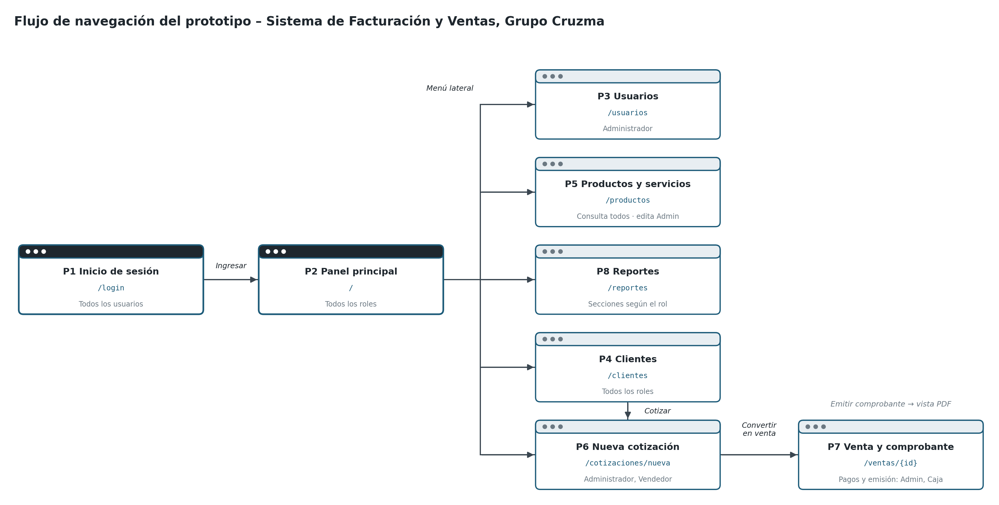

# Rutas y pantallas

| Método | Ruta | Controlador | Vista | Roles | Requisito |
|--------|------|-------------|-------|-------|-----------|
| GET/POST | `/login` | `LoginController.login` / Spring Security | `login` | Todos | RF01 |
| POST | `/logout` | Spring Security | — | Autenticado | RF01 |
| GET | `/` | `PanelController.panel` | `panel` | Autenticado | RF12, RF13 |
| GET | `/usuarios` | `UsuarioController.listar` | `usuarios/lista` | ADMIN | RF02 |
| POST | `/usuarios` | `UsuarioController.crear` | redirección | ADMIN | RF02 |
| POST | `/usuarios/{id}/estado` | `UsuarioController.cambiarEstado` | redirección | ADMIN | RF02 |
| GET | `/auditoria?entidad=&id=` | `AuditoriaController.historial` | `auditoria/historial` | ADMIN | Auditoría de datos |
| GET | `/clientes?q=&editar=` | `ClienteController.listar` | `clientes/lista` | Autenticado | RF03 |
| POST | `/clientes/guardar` | `ClienteController.guardar` | redirección | Autenticado | RF03 |
| GET | `/productos?tipo=&editar=` | `ProductoController.listar` | `productos/lista` | Autenticado | RF04 |
| POST | `/productos/guardar` | `ProductoController.guardar` | redirección | ADMIN | RF04 |
| GET | `/cotizaciones` | `CotizacionController.listar` | `cotizaciones/lista` | ADMIN, VENDEDOR | RF05 |
| GET | `/cotizaciones/nueva` | `CotizacionController.nueva` | `cotizaciones/form` | ADMIN, VENDEDOR | RF05 |
| POST | `/cotizaciones` | `CotizacionController.crear` | redirección | ADMIN, VENDEDOR | RF05 |
| GET | `/cotizaciones/{id}` | `CotizacionController.ver` | `cotizaciones/detalle` | ADMIN, VENDEDOR | RF06 |
| POST | `/cotizaciones/{id}/rechazar` | `CotizacionController.rechazar` | redirección | ADMIN, VENDEDOR | RF05 |
| POST | `/cotizaciones/{id}/convertir` | `CotizacionController.convertir` | redirección | ADMIN, VENDEDOR | RF07 |
| GET | `/ventas` | `VentaController.listar` | `ventas/lista` | Autenticado | RF08 |
| GET | `/ventas/{id}` | `VentaController.ver` | `ventas/detalle` | Autenticado | RF08, RF11 |
| POST | `/ventas/{id}/pagos` | `VentaController.pagar` | redirección | ADMIN, CAJA | RF08 |
| POST | `/ventas/{id}/emitir` | `VentaController.emitir` | redirección | ADMIN, CAJA | RF09 |
| GET | `/comprobantes` | `ComprobanteController.listar` | `comprobantes/lista` | Autenticado | RF11 |
| GET | `/comprobantes/{id}` | `ComprobanteController.ver` | `comprobantes/ver` | Autenticado | RF09 |
| POST | `/comprobantes/{id}/anular` | `ComprobanteController.anular` | redirección | ADMIN, CAJA | RF10 |
| GET | `/reportes?desde=&hasta=` | `ReporteController.ver` | `reportes/index` | Autenticado (secciones por rol) | RF12, RF13 |
| GET | `/reportes/exportar?formato=xlsx&desde=&hasta=` | `ReporteController.exportar` | archivo Excel | Autenticado | RF14 |
| GET | `/reportes/exportar?formato=csv&desde=&hasta=` | `ReporteController.exportar` | archivo CSV | Autenticado | RF14 |

Todos los formularios `POST` llevan token CSRF (Thymeleaf lo agrega con `th:action`). Tras un `POST` se redirige (patrón POST-redirect-GET)
y el resultado se muestra con los mensajes flash `ok` o `error`.
